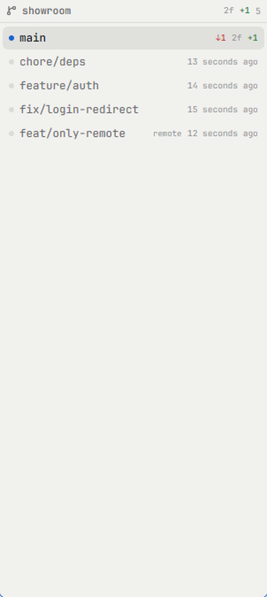

# Branches — a git branch panel for [Herdr](https://herdr.dev)

Lists the git branches of the space you are working in — the branch you are on at
the top, the rest newest commit first — with ahead/behind, the working tree's
`+N −M`, and click-to-switch behind a confirm dialog.



## Install

Copy `mods/git-branches/` into your Herdr home's `mods/` folder:

```
~/.config/herdr-app/mods/git-branches/
```

Herdr docks it on the left the first time it sees the folder. To place it yourself,
point a layout block or a pane at it:

```json
 "id": "branches", "type": "block", "size": { "px": 190 },
  "content": { "mod": "git-branches" } }
```

```
pane.split { direction: "right", mod: "git-branches", props: { folder: "C:/repo" } }
```

Then `herdr-app check ~/.config/herdr-app/mods/git-branches`.

## What it does

- Every local branch, plus remote-only ones (marked `remote`); the current branch
  on top and bold.
- `↑N` ahead and `↓N` behind the upstream, and `gone` when it is gone.
- The working tree's changed-file count and `+N −M` on the current branch.
- Click a branch you are not on: a dialog shows its last commit and warns about
  uncommitted files; `Checkout` runs `git checkout`. Clicking the current branch
  does nothing.
- A local repo is watched, so the list changes when git does; a remote space is
  polled every 4 seconds.

Read-only otherwise: no branch create/delete, no fetch/pull, no stash or rebase.

## Build it from scratch

`RECIPE.md` is the brief — what you see, how it behaves, what it is built from,
what trips a fresh build up, and how to know it works. `dialog.png` shows the
confirm dialog.

## License

MIT
