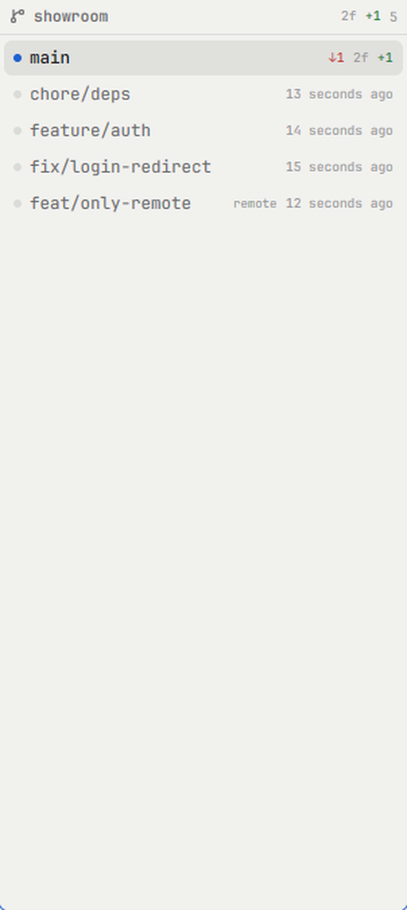
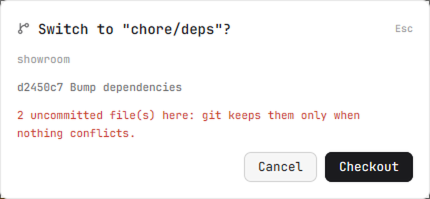

# Branches

A left-side panel that lists the git branches of the space you are working in:
the branch you are on at the top, the rest newest commit first, each with how far
off its upstream it is and the working tree's `+N −M`. Click a branch you are not
on to switch to it, after a dialog that shows its last commit and warns about
uncommitted files. Read-only until you confirm.

## What you see

A narrow panel (210 px by default, `mods/git-branches/mod.json`) with a header row
and a scrollable list under it. Background is the theme's `chrome`, text uses
`muted` / `foreground` / `dim`.

**Header row** (27 px): a branch glyph (12 px, `muted`), then the repository's
folder name in 11.5 px semibold `muted` — or the word "Branches" before a repo is
known. To its right, only while the working tree is dirty: the changed-file count
(`3f`, 9.5 px `dim`), lines added (`+42`, 9.5 px, `ansi2`), lines removed
(`−7`, 9.5 px, `ansi1`). While git is running, a spinner turns (11 px, `dim`).
The far right always shows the number of rows in `dim` (10 px).

**Each branch row** (26 px): a 6 px status dot, the branch name (12.5 px), then
badges on the right in 9.5 px. The dot is `accent` for the branch you are on and
`border` for every other. The current branch's name is `foreground` and semibold;
the others are `muted`. Two rows share a 1 px `gap`.

- **ahead / behind** (the current branch's upstream): `↑3` in `ansi2`, `↓1` in
  `ansi1`, and the word `gone` in `dim` when the upstream no longer exists. A local
  branch with its own upstream shows these whenever git reports them, not only when
  it is current.
- **the working tree** (`3f +42 −7`) sits on the current branch only, because that
  is the branch it belongs to.
- **remote-only branches** carry the word `remote` in `dim` before their age.
- **the age** (`2 hours ago`, git's own relative words) shows on every row that is
  not current and not busy.

Selecting/checking out a branch shows a 10 px spinner (`dim`) in place of its age
while git runs. The row you are on is filled `selected`; other rows fill `hover`
while the pointer is over them, and the cursor is a pointer.

**Below the list**, only when HEAD is detached (HEAD on no branch), a footer line
reads `Detached HEAD` (10 px, `dim`).

**The empty states** are one line of 11.5 px `dim` text, padded 10 px: `No space`
(no space to look at), `Not a git repo`, `git failed`, `git not found`, or
`No branches yet`.

**The dialog** (430 px wide, theme `popover`, 16 px padding, 12.5 px text) reads,
top to bottom: a branch glyph and `Switch to "feature/auth"?` (14 px semibold
`foreground`) with `Esc` in `dim` at the right; the repository's folder name (11 px
`dim`); the branch's last commit as `<short-hash> <subject>` (11 px `muted`), or
`No commits yet`; then `2 uncommitted file(s) here: git keeps them only when
nothing conflicts.` in `blocked` — or, on a clean tree, `Nothing uncommitted: the
checkout is clean.` in `dim`. A remote-only branch adds `No local branch yet: this
makes one that tracks it.` Every line is one line, truncated, never wrapped. At the
bottom right, `Cancel` (raised) and `Checkout` (solid). When a checkout fails, its
first error line appears above the buttons in `blocked` and the dialog stays.

## How it behaves

The list follows **the space on screen**: the marked space's folder, and git runs
on that space's machine. Switch spaces and the list reloads for the new one.

Branch order: the current branch first, then local branches, then remote-only ones;
within each group git's newest-commit-first order.

**Clicking a branch you are not on** reads that branch's last commit, shows a
spinner in its row, then opens the dialog, where nothing is written to the
repository. `Esc` or `Cancel` closes it. `Checkout` runs `git checkout <branch>`;
on success the dialog closes and a green `Branch switched · <branch> · <repo>`
toast appears; on failure the dialog stays and shows git's first error line in red
and the button works again. Switching to a remote-only branch is an ordinary
`git checkout <name>`, which creates a local branch tracking it (git's DWIM).

**Clicking the branch you are on does nothing** — its row still has the pointer
cursor and its `selected` fill, but no dialog.

**Freshness.** A local repository is watched, not polled: the checkout folder for
file edits, and `.git` (both this checkout's git dir and the repo's common dir) for
branches, checkouts and upstream moves. The list changes when git does. A remote
space cannot be watched, so it is asked every 4 seconds instead; if a local watch
fails (a tree too big for the platform's watch limit) the panel falls back to that
same 4-second timer. While a space has no repo yet, the timer also retries, so the
panel recovers on its own.

The panel reads nothing from disk itself and writes nothing except through
`git checkout`.

## Built from

One mod, `mods/git-branches/`, no layout changes required.

- `main.js` — the whole panel and the dialog. Default-exports a `View`.
- `mod.json` — ` "place": "left", "size": 210, "title": "Branches" }`: where
  Herdr docks it the first time it sees the folder.
- `git-branch.svg`, `spinner.svg` — its two icons; drawn with `svg(...)` so they
  take the text color, and the spinner with `.spin(900)` (native, no timer).

It uses one of two ways to decide where to look:

- a **layout** puts it in a block, and it follows the marked space:
  ` "id": "branches", "type": "block", "size": { "px": 190 }, "content": { "mod": "git-branches" } }`
- a **pane** names a folder directly, for a repository beside a shell:
  `pane.split { direction: "right", mod: "git-branches", props: { folder: "C:/repo" } }`
  (use forward slashes; see Watch out). `props.on` may name a machine.

`herdr` functions: `props()`, `spaces()`, `theme()`, `exec()`, `watchFolder()`,
`notify()`, `openOverlay()`, `closeOverlay()`. It reads `spaces()[i]` for `folder`,
`machine` and `active`; each space's `branch` is not used (the panel asks git
itself, so it can show every branch).

git, always through `exec("git", [...])` on that space's machine, each read
carrying `--no-optional-locks -c core.fsmonitor=false -c diff.autoRefreshIndex=false`
so a read never writes under `.git` and never wakes its own watch:

- `rev-parse --show-toplevel` — whether there is a repository, and its root.
- `rev-parse --path-format=absolute --absolute-git-dir` and `--git-common-dir` —
  what to watch (a linked worktree's HEAD/index live in its own git dir, refs in
  the shared one).
- `for-each-ref --sort=-committerdate --format=... refs/heads refs/remotes` — the
  rows. The format is `%(refname)%09%(HEAD)%09%(upstream:short)%09%(upstream:track)%09%(committerdate:relative)`;
  `%(refname)` (not `:short`) is what lets the code tell a local from a remote ref.
  `refs/remotes/*/HEAD` is skipped (it is a symref); a remote branch that has a
  local twin is dropped, since the local row already shows the gap.
- `status --porcelain=v2 --branch --untracked-files=normal` — the changed-file
  count, and whether HEAD is detached (`# branch.head (detached)`).
- `diff HEAD --numstat -z --no-renames` — lines added and removed (v2 lists files
  but not their line counts). `-` counts as 0 (a binary file).
- `log -1 --format=%h %s <branch>` — the dialog's one commit line.
- `checkout <branch>` — the only write, on `Checkout`.

## Watch out

- **`props()` from a pane is a JSON string, and Windows backslashes break it.**
  `pane.split { mod, props }` keeps props as typed, so
  `{"folder":"C:\Users\me\repo"}` is not valid JSON (single backslashes) and
  `JSON.parse` throws. Use forward slashes (`C:/Users/me/repo`). `readProps()`
  parses the string, and if that fails escapes every backslash and tries once more,
  then gives up to `{}`. A layout hands over an object already.
- **`%(refname:short)` is not a reliable local/remote test.** A remote branch's
  short name is `origin/main`, so `ref.startsWith("refs/remotes/")` never matches,
  and `refs/remotes/origin/HEAD` shortens to `origin` and slips past a `/HEAD`
  filter — you get a phantom branch. Use `%(refname)` and strip the prefix yourself.
- **Sort the `null`s out before you read a field.** The `HEAD`-symref skip returns
  `null`, so a following `.filter((b, _i, all) => ... b.remote ...)` reads `.remote`
  of `null` and throws. `.filter(Boolean)` first.
- **Never reuse a `cx` after an `await`.** `on_click((_e, cx) => this.propose(b, cx))`
  hands over the click's context; by the time `propose` has awaited git that context
  is spent, a later `cx.notify()` throws into the void, and the dialog never opens —
  silently. That is why the click does
  `cx.spawn(async (cx) => this.propose(b, cx))` and `propose` uses the context it
  is given. A timer is no place to hide this: the same code driven by `cx.timer`
  works, which makes the bug look intermittent.
- **A stuck `busy` swallows every later click.** If the `exec` throws (a machine
  away, git gone) the flag never clears, and `if (this.busy) return` silently
  ignores the panel forever after. `propose` clears it in a `finally` and toasts
  the failure.
- **Every clickable row needs `.cursor_pointer()`.** Herdr does not infer it; the
  shipped `files`, `changes`, `agents` and `confirm` mods all set it. Without it
  the row still clicks, but the pointer never changes, so it reads as dead.
- **A dialog opened from the click that asked for it can be closed by that same
  click's release.** (Observed in one build; here the open is not deferred, but if a
  dialog vanishes the instant it appears, defer the `openOverlay` with
  `cx.timer.after(80, ...)`.)
- **`refs/remotes` can be long.** A repository with many remote branches lists them
  all, remote-only ones included. There is no cap or search.
- **The 4-second fallback has no backoff.** A remote space is asked every 4 seconds
  whether or not anything changed.
- **Windows-only authoring.** Tested on Windows with PowerShell 7 and Git for
  Windows; on macOS and Linux the same git calls apply, but the folder-path
  escaping above is a Windows-shaped problem.
- **What it does not do:** no create / delete / rename branch, no fetch or pull, no
  stash, no rebase or merge, no worktree creation (that is Herdr's own `worktree`
  mod), and no diff of a branch (that is the `changes` mod).

## Done when

Each check is something this build really does.

1. `herdr-app check ~/.config/herdr-app/mods/git-branches` exits 0 with
   `check passed`. (Loads the mod and builds its description once.)
2. `herdr-app do pane.split --direction right --mod git-branches --props '{"folder":"<a repo with several branches>"}'`
   returns a pane, and `herdr-app shot /tmp/x.png` shows the header with that
   repository's folder name, the branch you are on at the top with its `selected`
   fill, and every branch as a row.
3. In a repo whose current branch is behind its upstream, the current row shows
   `↓N` in red; in one ahead, `↑N` in green; and a tracked branch whose upstream was
   deleted shows `gone`.
4. With an edited and an untracked file, the header shows `2f +N −0` and the
   current row repeats the counts.
5. Make a new branch in a terminal (`git branch scratch`) and the list grows within
   a second **without touching the panel** — the local watch, not the timer.
6. Click a branch you are not on: its row shows a spinner, then the dialog appears
   with the branch's last commit and the uncommitted-file warning. `Esc` closes it
   and nothing changed (`git branch --show-current` is the same).
7. `Checkout` on a clean tree switches the branch, the dialog closes, and a
   `Branch switched` toast appears; `git branch --show-current` matches.
8. `Checkout` with a dirty tree that conflicts leaves the dialog open with git's
   error in red, and the current branch unchanged.
9. Click the current branch: nothing opens.
10. A repository with a branch that exists only on the remote shows it with the
    word `remote`; clicking it and confirming creates a local branch that tracks
    it.
11. A folder that is not a repository shows `Not a git repo`, and switching to a
    space that is one loads its branches on its own.
